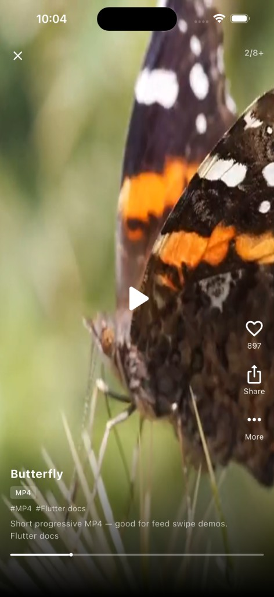
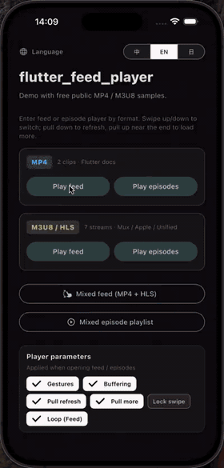

# flutter_feed_player

Vertical **short-video feed** and **series episode** players for Flutter, built on [`video_player`](https://pub.dev/packages/video_player).

Extracted from production TikTok-style / binge-episode UX patterns (parked controller promote, adjacent warm-up, exclusive audio). Host apps inject playable data — **no backend client is included**.

## Demo

Vertical short-video feed: center play button, like and share actions, and a bottom seek bar.



Swipe feed, pull-to-refresh, and load-more in the example app:



## Features

| Layer | Widget | Use case |
|-------|--------|----------|
| Convenience | `FeedPlayer` / `EpisodePlayer` | View + default chrome |
| Core | `FeedPlayerView` / `EpisodePlayerView` | Surface + gestures only |
| Components | `FeedPlayerChrome` / `EpisodePlayerChrome` | Default overlays (replace freely) |

- Park / promote `VideoPlayerController` map for instant swipe
- Adjacent preload with ~2s warm buffer
- Exclusive unmute (one audible player at a time)
- Auto-advance to next clip / episode on end (`autoAdvanceOnEnd`; mutually exclusive with effective loop)
- Tap play/pause, long-press 2×, seek bar with scrub time, speed and quality sheets (episode)
- Episode quality: labeled `EpisodeAsset`s, or an HLS master / variant rewrite (`Auto` / `1080p` / `720p` / `480p` / `360p`). A single progressive URL hides the control
- Episode pause glyph appears on tap while playing, not when a swipe auto-starts
- Center play/pause stays hidden until the first frame (no overlap with the white buffering spinner)
- Seek bar shows a center-out loading beam until the player is initialized
- Scrub focus: while dragging the seek bar, chrome hides meta / side actions
- Pull-to-refresh on first page / pull-up load-more on last page
- Multi-format playback: MP4 / HLS / MOV / M4V / WebM / DASH (platform-dependent)
- Network, Flutter asset (`asset://…`), and local `file:` URLs via `PlayerFactory.create`
- Optional `HttpHeadersProvider` / `UrlTransformer` for CDN auth
- Picture-in-picture (`enablePictureInPicture`): a playing clip opens the system window on background; a paused clip does not. The active page stays pinned across that resize

Player core and UI components are separated: keep the view, swap chrome via `overlayBuilder`.

### Format support (via `video_player`)

| Format | Android (ExoPlayer) | iOS / macOS (AVPlayer) | Web |
|--------|---------------------|------------------------|-----|
| MP4 / MOV / M4V | ✅ | ✅ | ✅* |
| HLS (`.m3u8`) | ✅ | ✅ | ✅* |
| WebM | ✅ | ❌ | ✅* |
| DASH (`.mpd`) / SS | ✅ | ❌ | ❌ |

\* Browser codec support still applies. Use `MediaFormat.isSupportedOnCurrentPlatform` / `unsupportedReason` to gate UI.

---

## 接入流程（Integration）

整体顺序：**依赖 → 数据映射 → Controller + loader → 选一层 Widget → 生命周期**。包内不含网络客户端，由宿主把接口 DTO 转成 `FeedItem` / `SeriesInfo`。

```
Host API / mock
      │  map → FeedItem / SeriesInfo / EpisodeItem
      ▼
FeedPlayerController / EpisodePlayerController   (loader 分页)
      ▼
┌─────────────────┬──────────────────┐
│ FeedPlayer      │ FeedPlayerView   │  ← 推荐流
│ EpisodePlayer   │ EpisodePlayerView│  ← 剧集
└────────┬────────┴────────┬─────────┘
         │ default chrome  │ overlayBuilder 自由拼装
         ▼                 ▼
   FeedPlayerChrome   FeedBottomChrome / FeedSideActions / …
```

### 1. 添加依赖

```yaml
dependencies:
  flutter_feed_player: ^0.1.6
```

```sh
flutter pub get
```

要求 Flutter `>=3.27.0`，与 [`video_player`](https://pub.dev/packages/video_player) `^2.10.0` 一致。确保目标平台已按该插件文档完成配置（如 Android 网络权限、iOS ATS）。网络渐进式媒体需支持 **HTTP Range**（尤其 AVPlayer）。

### 2. 映射播放数据

宿主接口返回什么都可以，**最终必须变成**下列模型再交给 loader：

| 模型 | 用途 |
|------|------|
| `FeedItem` | 推荐流单卡（标题、点赞、内嵌 `EpisodeItem` 等） |
| `EpisodeItem` | 单集；用 `playUrl` 或 `assets[].url` |
| `EpisodeAsset` | 多清晰度 / 多 locale / 多格式资源 |
| `SeriesInfo` | 剧集元数据 + `episodes` 列表 |
| `MediaFormat` | 从 URL / `assetType` 推断格式、徽章文案、平台是否可播 |

播放地址由 `PlayerFactory.resolvePlayUrl` 解析（剧集控制器按当前 `quality` 调用）：

| 清晰度 | 解析 |
|--------|------|
| `Auto`（或空） | 优先 `playUrl`；为空则取 HLS asset，再退到第一个非空 `assets[].url`。可改写的 HLS 归一到 `master.m3u8` |
| 命名清晰度（如 `720p`） | 优先匹配同名 `EpisodeAsset.quality`；否则把可改写 HLS 改成 `/v{高度}/index.m3u8` |

可改写 HLS 指路径以 `/master.m3u8` 或 `/v{高度}/index.m3u8` 结尾。选中的 variant 会锁定，工厂不会再把它改回 master。其它地址原样播放。

支持的 URL 形态：

| 形态 | 示例 |
|------|------|
| 网络 | `https://cdn.example.com/a.mp4` / `.m3u8` / `.mpd` |
| Flutter asset | `asset://assets/videos/clip.webm`（或直接 `assets/...`） |
| 本地文件 | `file:///…`（非 Web） |

```dart
import 'package:flutter_feed_player/flutter_feed_player.dart';

FeedItem mapFeedDto(YourFeedDto dto) {
  return FeedItem(
    id: dto.id,
    seriesId: dto.seriesId,
    title: dto.title,
    coverUrl: dto.cover,
    description: dto.desc,
    tags: dto.tags,
    likeCount: dto.likes,
    isLiked: dto.liked,
    ctaText: 'Watch full series',
    episode: EpisodeItem(
      episodeId: dto.episodeId,
      episodeNo: dto.episodeNo,
      playUrl: dto.streamUrl, // MP4 / HLS / MOV / … 或 asset://…
      // 或：assets: [EpisodeAsset(assetType: 'hls', url: dto.hlsUrl)],
    ),
  );
}

SeriesInfo mapSeriesDto(YourSeriesDto dto, List<YourEpDto> page) {
  return SeriesInfo(
    seriesId: dto.id,
    title: dto.title,
    coverUrl: dto.cover,
    description: dto.desc,
    episodes: page
        .map(
          (e) => EpisodeItem(
            episodeId: e.id,
            episodeNo: e.no,
            title: e.title,
            playUrl: e.url,
          ),
        )
        .toList(),
  );
}
```

`EpisodeItem` / `FeedItem` 暴露 `isHls`、`isDash`、`formatLabel`（如 `HLS` / `DASH` / `WebM` / `MOV` / `MP4`），chrome 可直接用作格式徽章。

### 3. 推荐流（Feed）接入

**步骤：**

1. 实现 `FeedPageLoader`：`(page) → Future<List<FeedItem>>`，页码从 **1** 开始；没有更多时返回 **空列表**（或长度 `< pageSize`）。
2. 创建 `FeedPlayerController`（与 `pageSize` 对齐，便于判断 `hasMore`）。
3. 在 `State.initState` 里创建 Controller，在 `dispose` 里 `controller.dispose()`。
4. 挂载 `FeedPlayer`（默认 UI）或 `FeedPlayerView`（自定义 chrome）。

```dart
class FeedPage extends StatefulWidget {
  const FeedPage({super.key});

  @override
  State<FeedPage> createState() => _FeedPageState();
}

class _FeedPageState extends State<FeedPage> {
  static const _pageSize = 10;
  late final FeedPlayerController _controller;

  @override
  void initState() {
    super.initState();
    _controller = FeedPlayerController(
      loader: (page) async {
        final list = await yourApi.fetchFeedPage(page, size: _pageSize);
        return list.map(mapFeedDto).toList();
      },
      pageSize: _pageSize,
      // 默认 autoAdvanceOnEnd: true（播完滑下一则）。短视频循环请见下表。
      loopClips: true,              // 仅当 autoAdvanceOnEnd == false 时生效
      autoAdvanceOnEnd: false,      // false + loopClips → 单卡循环
      lockForwardWhileCold: false,  // HLS 冷启动时建议保持 false
      enablePictureInPicture: false, // 播放中进后台出系统小窗，见「画中画」
      // headersProvider / urlTransformer — 见下文 CDN
    );
  }

  @override
  void dispose() {
    _controller.dispose();
    super.dispose();
  }

  @override
  Widget build(BuildContext context) {
    return Scaffold(
      backgroundColor: Colors.black,
      body: FeedPlayer(
        controller: _controller,
        bottomInset: MediaQuery.paddingOf(context).bottom,
        onWatchFullSeries: (index) {
          final item = _controller.items[index];
          // 跳转 EpisodePlayer，传入 seriesId / 起始集
        },
        onShare: (index) { /* 分享 */ },
        onMore: (index) { /* 更多菜单 */ },
      ),
    );
  }
}
```

`FeedPlayerView` 默认 `autoInit: true`，首帧会调用 `controller.init()` → `refresh()` 拉第 1 页。也可自行 `await controller.init()`。

**循环 vs 自动下一则：**

| `loopClips` | `autoAdvanceOnEnd` | 实际行为 |
|-------------|--------------------|----------|
| `true` | `false` | 当前卡循环（短视频常见） |
| `*` | `true`（默认） | 播完动画滑到下一则；`effectiveLoopClips == false` |
| `false` | `false` | 播完停在片尾 |

运行时可调用 `setLoopClips` / `setAutoAdvanceOnEnd`；开启自动下一则时会强制关闭原生 looping。

**分页手势：**

| 手势 | 行为 | 开关 |
|------|------|------|
| 首页下拉 | `refresh()` | `enablePullToRefresh` |
| 末页上拉 | `loadMore()` | `enablePullToLoadMore` |
| 靠近末尾 | 自动预取下一页 | 内置 |

### 4. 剧集（Episode）接入

**步骤：**

1. 实现 `SeriesLoader`：`(page) → Future<SeriesInfo>`，页码从 **1** 开始。
2. **第 1 页必须带齐系列元数据**（`seriesId` / `title` / …）+ 本页 `episodes`。
3. **后续页只需填 `episodes`**（其它字段会被忽略）；空列表表示没有更多。
4. 可选 `initialEpisodeId` / `initialEpisodeNo` 定位开播集。
5. 挂载 `EpisodePlayer` 或 `EpisodePlayerView`。

```dart
class SeriesPage extends StatefulWidget {
  const SeriesPage({super.key, required this.seriesId});

  final String seriesId;

  @override
  State<SeriesPage> createState() => _SeriesPageState();
}

class _SeriesPageState extends State<SeriesPage> {
  static const _pageSize = 10;
  late final EpisodePlayerController _controller;

  @override
  void initState() {
    super.initState();
    _controller = EpisodePlayerController(
      loader: (page) async {
        final raw = await yourApi.fetchSeriesPage(
          widget.seriesId,
          page: page,
          size: _pageSize,
        );
        return mapSeriesDto(raw.meta, raw.episodes);
      },
      pageSize: _pageSize,
      initialEpisodeNo: 1,
      lockForwardWhileCold: false,
      // 默认 true：播完自动滑到下一集；末页会先 loadMore
      autoAdvanceOnEnd: true,
      enablePictureInPicture: false, // 播放中进后台出系统小窗，见「画中画」
    );
  }

  @override
  void dispose() {
    _controller.dispose();
    super.dispose();
  }

  @override
  Widget build(BuildContext context) {
    return Scaffold(
      backgroundColor: Colors.black,
      body: EpisodePlayer(
        controller: _controller,
        onBack: () => Navigator.of(context).maybePop(),
        onShare: () { /* 分享 */ },
        onOpenEpisodeList: () { /* 选集面板 */ },
      ),
    );
  }
}
```

默认 `quality` 为 `720p`。`EpisodePlayer` 顶栏在可选项多于一个时显示当前清晰度，点击打开 `showEpisodeQualitySheet`。`setQuality` 保持进度和播放 / 暂停，并丢掉已预热的相邻集，下一集按同一清晰度加载。

| 数据 | 顶栏选项 |
|------|----------|
| 两个及以上带 `quality` 的 `EpisodeAsset` | `Auto` + 这些标签（按高度从高到低） |
| 没有显式多清晰度，但 URL 可改写 | `Auto`、`1080p`、`720p`、`480p`、`360p` |
| 只有一条渐进式地址 | 不显示清晰度按钮 |

```dart
EpisodeItem(
  episodeId: e.id,
  playUrl: e.masterUrl, // Auto 走这条；可改写时归一到 master.m3u8
  assets: [
    EpisodeAsset(assetType: 'hls', quality: '1080p', url: e.url1080),
    EpisodeAsset(assetType: 'hls', quality: '720p', url: e.url720),
  ],
);
```

### 5. 选择接入层级

| 需求 | 用法 |
|------|------|
| 最快上线、默认 TikTok 风格 UI | `FeedPlayer` / `EpisodePlayer` |
| 完全自定义浮层 | `FeedPlayerView` / `EpisodePlayerView` + `overlayBuilder` |
| 半定制 | `overlayBuilder` 里混用 `FeedBottomChrome`、`FeedSideActions` 等积木 |

#### 自定义 chrome（推荐流）

```dart
FeedPlayerView(
  controller: controller,
  overlayBuilder: (context, slot) {
    if (!slot.isActive) return const SizedBox.shrink();
    return Stack(
      children: [
        if (slot.controller.showCenterPlay && slot.controller.videoFrameReady)
          const FeedCenterPlayIcon(),
        FeedSideActions(
          bottomInset: 0,
          liked: slot.item.isLiked,
          likeCount: slot.item.likeCount,
          onLike: () => slot.controller.toggleLike(slot.index),
          onShare: () { /* … */ },
          onMore: () { /* … */ },
        ),
        FeedBottomChrome(
          bottomInset: 0,
          title: slot.item.title,
          description: slot.item.description,
          tags: slot.item.tags,
          ctaText: slot.item.ctaText,
          formatLabel: slot.item.formatLabel,
          seekController: slot.player,
          // 拖拽进度条时可用 onScrubbingChanged 隐藏其它浮层
        ),
        // 也可完全自绘，使用 slot.controller / slot.item / slot.player
      ],
    );
  },
);
```

剧集侧同理：用 `EpisodePlayerSlot` + `EpisodeTopBar` / `EpisodeBottomChrome` / `EpisodeCenterControl` 等，或整页换成自己的 UI。清晰度把 `controller.quality` 和 `onQuality` 传给 `EpisodeTopBar`（选项用 `qualityOptionsFor`，选中后 `setQuality`），或直接调用 `showEpisodeQualitySheet`。

中心播放/暂停：

| 状态 | 行为 |
|------|------|
| 首帧未到（`!videoFrameReady`） | 不画中心按钮，只留白色缓冲圈 |
| 推荐流暂停 | `showCenterPlay` 为真时画 `FeedCenterPlayIcon` |
| 剧集刚进入 / 上下滑自动开播 | `showCenterPause` 为假，不闪暂停 |
| 剧集播放中第一次点屏幕 | `toggleChrome()` 打开暂停按钮，不收起控件 |
| 剧集再次点空白处 | 收起 chrome，并清掉暂停按钮 |
| 剧集已暂停 | `showCenterPlay` 为真时画播放图标 |

`EpisodeCenterControl` 是纯图标（无圆形水波底），颜色用 `color`（默认 `Colors.white70`）。Example 里传 `Colors.white`。

默认 chrome（`FeedPlayerChrome` / `EpisodePlayerChrome`）在 **scrub 拖拽** 时会收起标题、侧栏等，只保留进度条与时间码；`PlayerSeekBar` / `*BottomChrome` 暴露 `onScrubbingChanged` 便于自绘同样行为。播放器尚未 `isInitialized` 时，进度条位置是一条从中心向两侧展开、再淡出循环的加载光条（约 700ms，比播放轨道细 1px）。缓冲圈（画面中央与下拉刷新）为纯白。

`loadingBuilder` / `errorBuilder` 可替换首屏加载、空列表错误壳。冷启动过久时 `showLoadingPrompt` 只在缓冲指示下显示软提示文案，**不再**当作重试页；硬错误（含超时）才走 retry overlay。

### 6. CDN 鉴权 / URL 改写（可选）

在 Controller 构造时注入：

```dart
FeedPlayerController(
  loader: loader,
  headersProvider: ({required url, required isHls}) => {
    'Authorization': 'Bearer $token',
    if (!isHls) 'User-Agent': 'MyApp/1.0',
  },
  urlTransformer: (url) => appendExpireQuery(url),
);
```

`EpisodePlayerController` 参数相同。默认不再注入自定义 User-Agent（部分 CDN 会与 Range 请求冲突）；需要时通过 `headersProvider` 自行添加。

### 7. 生命周期与其它约定

- **必须**在宿主 `State.dispose` 中调用 `controller.dispose()`，释放 parked / active 播放器。
- 页面不可见时，View 会配合暂停；需要后台播放可设 `allowBackgroundPlayback: true`（慎用）。画中画会自行让当前播放器在后台继续播，不必再单独打开这个开关。
- 画中画见下一小节。默认 `enablePictureInPicture: false`。
- Demo 在 `main` 里调用了 `PlaybackMemory.init()`（记忆进度）；宿主按需同样初始化。
- `FeedItem.identity` / `episodeId` 尽量稳定唯一，便于 park 缓存命中。
- 从 Feed 进剧集：在 `onWatchFullSeries` 里 `Navigator.push` 打开带同一 `seriesId` 的 `EpisodePlayer`。
- WebM / DASH 在 iOS/macOS 不可播；可用 `MediaFormat` 过滤列表或展示 `unsupportedReason`。
- View 会绑定 `controller.animateToIndex`，供 `autoAdvanceOnEnd` 驱动 `PageView` 动画；自建列表时需自行赋值。

#### 画中画（Picture-in-picture）

`FeedPlayerController` / `EpisodePlayerController` 设 `enablePictureInPicture: true`。正在播放、且用户没有暂停时进入后台，系统会出小窗；已暂停则不会。小窗期间 `inPictureInPicture` 为 true，默认 View 会收起手势、缓冲圈和 chrome。回到前台后停在当前页。

进入后台或窗口明显缩放时会钉住当前页，避免 `PageView` 被滑到下一条；这段时间也会暂停自动下一则。通知栏、控制中心不会出小窗。

开启画中画后，当前播放器按可后台播放创建。iOS 会改用 `VideoViewType.platformView`（系统画中画要绑到屏幕上的 `AVPlayerLayer`），画面铺满页面。Web / 桌面没有系统小窗，相关调用会被忽略。

包内带 Android / iOS 插件 `FlutterFeedPlayerPlugin`，`flutter pub get` 后会注册。宿主还要完成下面的平台配置。Example 已接好。

**Android（8.0+；自动进入需要 12+）**

Activity 声明：

```xml
android:supportsPictureInPicture="true"
android:resizeableActivity="true"
android:configChanges="orientation|keyboardHidden|keyboard|screenSize|smallestScreenSize|locale|layoutDirection|fontScale|screenLayout|density|uiMode"
```

`configChanges` 里要有 `screenSize` 和 `smallestScreenSize`，否则进小窗会重建 Activity。

把离开应用和画中画状态转发给插件。12 以下靠 `onUserLeaveHint` 进入；12 及以上由系统在真正离开应用时自动进入。

```kotlin
import android.content.res.Configuration
import dev.martcodex.flutter_feed_player.FlutterFeedPlayerPlugin
import io.flutter.embedding.android.FlutterActivity

class MainActivity : FlutterActivity() {
    override fun onUserLeaveHint() {
        FlutterFeedPlayerPlugin.onUserLeaveHint()
        super.onUserLeaveHint()
    }

    override fun onPictureInPictureModeChanged(
        isInPictureInPictureMode: Boolean,
        newConfig: Configuration,
    ) {
        FlutterFeedPlayerPlugin.onPipModeChanged(isInPictureInPictureMode)
        super.onPictureInPictureModeChanged(isInPictureInPictureMode, newConfig)
    }
}
```

**iOS**

`Info.plist` 增加后台音频模式（Xcode 里即 Audio, AirPlay, and Picture in Picture）：

```xml
<key>UIBackgroundModes</key>
<array>
    <string>audio</string>
</array>
```

插件会在当前画面的 `AVPlayerLayer` 上武装自动画中画，真正进入后台时才出窗。

### 8. 接入检查清单

- [ ] `pubspec` 依赖 `flutter_feed_player`
- [ ] DTO → `FeedItem` / `SeriesInfo` / `EpisodeItem`，且 `playUrl` 或 `assets` 可播
- [ ] 目标平台支持该格式（见上方矩阵）；网络流支持 HTTP Range
- [ ] `loader` 分页从 1 开始；耗尽返回空列表；`pageSize` 与接口一致
- [ ] 剧集第 1 页带系列元数据
- [ ] `Controller` 在 `dispose` 中释放
- [ ] 选用 `*Player` 或 `*PlayerView` + chrome
- [ ] 需要鉴权时配置 `headersProvider` / `urlTransformer`
- [ ] 按需配置 `loopClips` / `autoAdvanceOnEnd`（二者有效互斥）
- [ ] 多清晰度时填写 `EpisodeAsset.quality`，或提供可改写的 HLS master / variant 地址
- [ ] 需要画中画时设 `enablePictureInPicture`，并完成 Android Activity / iOS `UIBackgroundModes` 配置
- [ ] 真机验证竖滑、下拉刷新、上拉加载、播完自动下一则、音画互斥

---

## Quick start — feed

```dart
final controller = FeedPlayerController(
  loader: (page) async {
    // Map your API (or mock) → List<FeedItem>
    return mockFeedPage(page);
  },
  // Defaults: autoAdvanceOnEnd: true. For looping shorts:
  // loopClips: true, autoAdvanceOnEnd: false,
  // enablePictureInPicture: true, // host setup required — see README
);

FeedPlayer(
  controller: controller,
  onWatchFullSeries: (index) { /* open EpisodePlayer */ },
  onShare: (index) { /* … */ },
  onMore: (index) { /* … */ },
);
```

## Quick start — episodes

```dart
final controller = EpisodePlayerController(
  loader: (page) async => mockSeriesPage(page),
  pageSize: 10,
  initialEpisodeNo: 1,
  // autoAdvanceOnEnd: true (default) — binge to next episode
  // enablePictureInPicture: true, // host setup required — see README
);

EpisodePlayer(controller: controller);
```

Default episode quality is `720p`. The top bar shows it when more than one rendition exists. Pass labeled `EpisodeAsset`s, or a convertible HLS URL (`/master.m3u8` / `/v{height}/index.m3u8`). See the integration section above for the option table and `setQuality`.

## Demo

```sh
cd example
flutter run
```

Example home lists format filters available on the **current platform** (MP4 / HLS / MOV / M4V; plus WebM / DASH where supported). Samples include public network streams and a bundled WebM under `asset://assets/videos/…`. Demo pages expose grouped playback toggles (gestures, pull refresh/load-more, lock-forward, loop, auto-advance, picture-in-picture) and compose chrome via `overlayBuilder`. The example Android activity and iOS `Info.plist` already include the picture-in-picture host setup.

## Models

```dart
FeedItem / EpisodeItem / EpisodeAsset / SeriesInfo / MediaFormat
```

Provide `playUrl` and/or `assets[].url`. Set `EpisodeAsset.quality` (`1080p`, `720p`, …) when a clip has multiple renditions. Convertible HLS (`/master.m3u8` or `/v{height}/index.m3u8`) can also be rewritten by `HlsQualityUrl`: `Auto` becomes `master.m3u8`, a named quality becomes `/v{height}/index.m3u8`. `formatLabel` / `isHls` / `isDash` come from `MediaFormat`.

## Public chrome building blocks

**Feed:** `FeedPlayerChrome`, `FeedCenterPlayIcon`, `FeedSideActions` (like / share / more), `FeedBottomChrome`, `FeedActionButton`, `PlayerSeekBar`

**Episode:** `EpisodePlayerChrome`, `EpisodeTopBar` (back / title / quality / speed), `EpisodeCenterControl`, `EpisodeSideActions`, `EpisodeBottomChrome`, `EpisodeBoostBadge`, `showEpisodeQualitySheet`, `showEpisodeSpeedSheet`

`PlayerSeekBar` shows a center-out loading beam while uninitialized (one pixel thinner than the playback track), then a progress thumb, scrub time labels (`current / total`), and `onScrubbingChanged`. `EpisodeCenterControl` takes `color` and draws a plain play/pause icon. Gate center glyphs with `videoFrameReady`; for episodes also use `showCenterPause` (tap-to-reveal while playing) and `showCenterPlay` (paused). Quality labels come from `EpisodePlayerController.qualityOptionsFor`; apply a choice with `setQuality`.

## License

MIT
